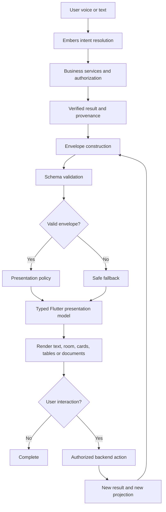
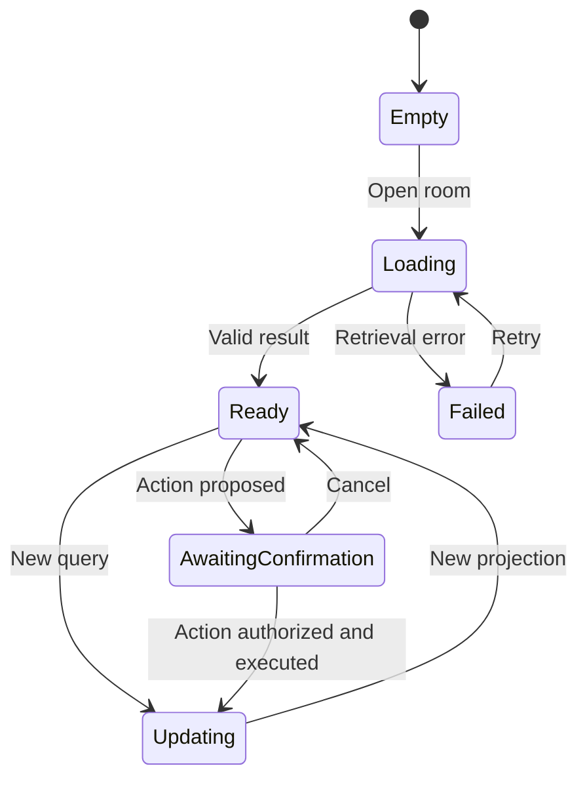

> **Status:** proposed. **Verified:** not yet. **Owns:** none.

> **Provenance.** Pasted into chat by Pierre on 2026-10-20 as "the vision". It was written by an AI assistant in another conversation, and it says of itself that its envelope is "an illustrative contract, not a claim that these fields already exist". The external image links and their captions have been removed; everything else is as pasted. **This file is the AIM. What is BUILT is `ENVELOPE.md` (the reply envelope, Phase 1) and `CONTEXT.md`; `VISION.md` has a short map of where the two differ.**

### The Office — Projection Layer Design

### 1\. The fundamental idea

The projection layer is the part of The Office that takes a result produced by its intelligence and business systems and turns it into something the user can see, hear, understand, inspect, and act on.

It is the bridge between what The Office knows and how The Office communicates that knowledge to a human.

Your existing Embers interface, central orb, business modules, and Flutter/Dart application give this layer a natural home. The projection layer should connect them without becoming another business-logic engine.

Consider a user asking:

> “What does Jenny owe us?”

The system must do several different things:

* Identify the user's intent.

* Resolve which Jenny they mean.

* Retrieve the relevant customer records.

* Calculate the amount owed using authoritative business data.

* Return a structured result.

* Decide how that result should be presented.

* Let Flutter render the answer as speech, a financial summary, a customer record, or a detailed report.

The projection layer begins at step 5 and handles the presentation decisions in step 6. Flutter performs the actual rendering in step 7.

The calculation of Jenny's balance belongs to the business layer, not the projector. The decision about whether the user has permission to see the balance belongs to the authorization layer.

That separation is the foundation of the design.

Embers / Intelligence

Understands the request and coordinates the work

Business services + authorization

Verified facts, permissions, calculations and action status

Projection layer

Typed reply envelope, presentation intent, content and available interactions

Flutter presentation layer

Orb, voice, rooms, cards, tables, charts, documents and transitions

The key architectural decision is that the projector describes the intended presentation; it does not draw the interface or decide business outcomes.

This allows The Office to use the same verified result across the voice interface, the main workspace, a financial room, a generated PDF, and eventually other clients connected through an API or MCP.

### 2\. The three contracts you need to keep separate

Before defining individual components, establish three contracts. This is what prevents the projection layer from gradually turning into a tangled mixture of AI logic, database queries, and Flutter UI code.

Contract A — Intelligence to projection

The reply envelope

Carries the reply text, verified result references, presentation intent, content blocks, warnings, and suggested interactions. It describes what Embers wants to communicate.

Contract B — Projection to Flutter

The presentation model

Converts the envelope into a validated, predictable model that Flutter can render using approved components, navigation rules, loading states, and layout policies.

Contract C — Projection to execution

The action boundary

Carries references to permitted actions, confirmation requirements, and their current status. Executing an action requires a separate authorized backend request; displaying a button never grants permission.

These contracts can be implemented in one application initially. They do not require three separate workers or services.

### What the projector must never do

* Recalculate invoices, balances, VAT, or financial totals.

* Invent facts to fill gaps in a response.

* Treat a guessed customer or supplier match as confirmed.

* Bypass business permissions because a response contains an action.

* Allow an AI-generated component type to instantiate arbitrary Flutter widgets.

* Assume that displaying a confirmation button means the action has been authorized or completed.

The projection layer should be deterministic. Given the same validated envelope, presentation capabilities, and application state, it should produce the same presentation model.

### 3\. The reply envelope: the centre of the architecture

The envelope is the most important piece of the projection layer because it defines the stable language between Embers and the visual environment.

You have already explored wrapping the output of `processTranscript` without breaking the existing response. Preserve that compatibility: the envelope should extend the existing result rather than force every existing consumer to migrate at once.

A conceptual envelope could look like this:

```json

{
  "schemaVersion": "1.0",
  "replyId": "reply_123",
  "intent": {
    "mode": "open_room",
    "room": "finance",
    "reason": "customer_balance"
  },
  "message": {
    "text": "Jenny has an outstanding balance.",
    "speechText": "Jenny has an outstanding balance."
  },
  "content": [
    {
      "id": "balance_summary",
      "type": "metric",
      "title": "Outstanding balance",
      "value": {
        "amountMinor": 1250000,
        "currency": "ZAR"
      },
      "sourceRef": "customer_balance_123"
    }
  ],
  "references": [
    {
      "type": "customer",
      "id": "customer_123",
      "label": "Jenny"
    }
  ],
  "actions": [],
  "warnings": [],
  "provenance": {
    "status": "verified",
    "source": "business_service"
  }
}
```

This is an illustrative contract, not a claim that these fields already exist in your codebase. The example uses R12,500 as a fictional balance.

### Recommended envelope structure

| Field         | Responsibility                                                               |
| ------------- | ---------------------------------------------------------------------------- |
| schemaVersion | Identifies the contract version.                                             |
| replyId       | Identifies this particular response for tracing and UI lifecycle management. |
| intent        | Describes the requested presentation mode and destination.                   |
| message       | Supplies human-readable and optional speech-ready text.                      |
| content       | Contains typed presentation blocks.                                          |
| references    | Identifies the business records associated with the response.                |
| actions       | Describes available interactions and their authorization requirements.       |
| warnings      | Explains missing data, partial results, ambiguity, or other limitations.     |
| provenance    | Communicates the verification state and origin of the information.           |

I would also reserve optional fields for correlation IDs, timestamps, pagination, and a presentation policy version. Add them when the implementation needs them rather than making every field mandatory immediately.

### A critical distinction: facts versus presentation instructions

The envelope contains two fundamentally different categories of information.

### Verified business content

The information the application is allowed to communicate.

* Customer balance and currency

* Invoice identifiers and statuses

* Transaction dates

* Source record references

* Verification and completeness status

### Presentation intent

Instructions for how the application should communicate that information.

* Speak a concise answer

* Open the finance room

* Show a metric and a table

* Display an analysis panel

* Ask the user to clarify

* Request confirmation for an available action

An AI model may help select presentation intent, but it must not be the authority for whether a business fact is verified. Verification status should originate from the backend's actual processing and validation results.

For example, an LLM cannot set `provenance.status` to `verified` simply because it sounds confident.

### 4\. The presentation modes

The mode is a high-level instruction to the application. It should not be a collection of arbitrary screen names.

I would start with the modes already aligned with your work on the Office reply envelope.

`speak` — Conversational response

The orb remains the primary focus. Embers speaks or displays the answer, with optional supporting content.

Example: “Your three most recent jobs are ready for review.”

`open_room` — Navigate to a workspace

Opens the appropriate room, such as Finance, Suppliers, Tasks, or People. It can carry a record reference or a contextual destination.

Example: “Open Jenny's account.”

`update_workspace` — Update the current view

Changes the active workspace's content without unnecessarily navigating away from it.

Example: Filter the invoice list to overdue invoices.

`analysis` — Present a deeper explanation

Shows the evidence, breakdown, trends, calculations supplied by business services, and relevant caveats.

Example: “Why did our expenses increase this month?”

`confirm` — Present a pending decision

Displays the exact proposed action, its target, and the information needed for explicit authorization. This mode does not itself execute anything.

`clarify` — Resolve ambiguity

Keeps the conversation active and asks a focused question. If there are two customers named Jenny, the application should not silently select one.

`refuse` — Explain a boundary

Communicates that an action is unavailable or disallowed, with a safe explanation and a permitted alternative where appropriate.

The modes should be a closed, versioned enumeration in Dart and on the backend. Unknown modes must fall back safely to `speak`, with the text preserved where possible.

### Mode is not content type

This distinction is important.

`open_room` tells Flutter where the user should go. A `metric`, `table`, `chart`, or `document` describes what the room should display.

A single response might therefore contain:

* Mode: `open_room`

* Destination: `finance`

* Content: a balance metric, outstanding invoice table, and payment history

* Message: a short spoken summary

Do not create a new mode for every combination of room and content.

### 5\. The content projection system

The content system determines which reusable visual components can represent a business result. It is effectively a small, typed vocabulary shared by the backend and Flutter.

Do not let the AI describe arbitrary layouts in raw HTML or generate custom Dart code. Give it a finite set of supported content types, and let Flutter decide how those types are rendered.

### The initial content vocabulary

`text` and `notice`

Explanations, summaries, warnings, empty states and contextual guidance.

`metric`

A single verified number with a label, unit, currency and optional comparison period.

`table` and `record_list`

Invoices, jobs, supplier records, people, transactions and other collections of business data.

`chart`

Time series, category breakdowns and comparisons, with explicit units and reporting periods.

`document`

Invoice previews, reports, bid packs, statements and PDFs, using existing document-generation services.

`comparison` and `evidence`

Side-by-side alternatives, supporting records, source dates and explanations of how an answer was derived.

These types should be sufficient for the first implementation. Add specialized types only when an actual workflow requires them.

### Each content block needs a stable schema

For example, a table projection needs more than a list of maps:

* A stable block ID.

* A title and optional description.

* Typed columns with stable field keys.

* Rows with stable record IDs.

* Correct data types for dates, currencies, numbers, and statuses.

* Pagination metadata when appropriate.

* A record reference if opening a row is supported.

* Provenance or warnings when the data is incomplete.

The Flutter table component owns column widths, overflow, responsive behaviour, and visual styling. The envelope supplies data and semantics.

Similarly, a chart block should carry data points, series definitions, units, and time ranges. Flutter should not have to interpret an ambiguous natural-language instruction such as “make this a nice graph.”

### Prefer typed values over formatted strings

For financial information, the API should ideally return a value with an explicit currency and a precise numeric representation. For example:

```json

{
  "amountMinor": 1250000,
  "currency": "ZAR"
}
```

This represents R12,500.00 when the currency uses two minor-unit decimal places.

Flutter formats it for the user's locale. The same numeric value can be used in a table, a metric card, or a PDF without parsing a display string.

Do not assume every currency uses two decimal places. The formatter should follow the currency's rules, and calculations must remain in the authoritative business service.

### 6\. The projection pipeline

The pipeline should be explicit and observable, with a clear point where untrusted model output becomes a validated presentation contract.



Here is how I would implement each stage.

### Stage 1 — Intent resolution

Embers interprets the request and determines whether the user is asking a question, requesting a workspace, exploring an analysis, or attempting an action.

Intent resolution is not authorization. “Pay this supplier” may identify an intended action, but it does not mean the payment can be executed.

### Stage 2 — Business result

The relevant business service retrieves or calculates the result.

For your architecture, this is where existing D1-backed business operations, permission checks, and any necessary Durable Object coordination remain authoritative.

A response should distinguish between:

* A complete and verified result.

* A partial result.

* An unresolved entity.

* A result that could not be retrieved.

* An action that is proposed, pending authorization, or completed.

### Stage 3 — Envelope construction

Construct the envelope from validated results and an allowlisted presentation intent.

Where possible, use deterministic backend code for this step. The LLM may suggest a mode or content arrangement, but backend code should validate the choice and attach the actual business data.

### Stage 4 — Schema validation

Validate the envelope before it reaches Flutter.

Check required fields, supported modes, content types, value types, permitted destinations, payload size, and references. Unknown fields can be ignored where forward compatibility allows it, but unsupported instructions must not execute.

If validation fails, preserve a safe human-readable response when available and fall back to a basic conversational presentation.

### Stage 5 — Presentation policy

Flutter receives the validated envelope and applies client-side rules.

For example:

* A small metric can appear in a compact card.

* A detailed table can open in the relevant room.

* A long explanation can remain in a scrollable analysis panel.

* A PDF can open in the document viewer.

* A confirmation request can display a review screen.

* A clarification should keep the orb and conversation context active.

The policy should consider screen size, current navigation state, supported capabilities, and user preferences. It should not change the underlying business meaning.

### Stage 6 — Render and interact

Flutter renders the content through a registry of known components.

Every interactive component emits a typed intent or action request. The backend then checks the user's identity, tenant membership, permission grants, target record, and any required confirmation before executing the operation.

The resulting state is projected again. This is how you maintain a consistent interface without making the UI responsible for business truth.

### 7\. How this fits into your Flutter/Dart application

I would implement the client side as a small module inside The Office, not as another service.

One possible structure is:

```text

lib/
  projection/
    contracts/
      reply_envelope.dart
      presentation_intent.dart
      content_block.dart
      action_descriptor.dart
      provenance.dart

    parsing/
      envelope_decoder.dart
      envelope_validator.dart

    policy/
      presentation_policy.dart
      navigation_policy.dart
      capability_policy.dart

    models/
      presentation_model.dart
      presentation_state.dart

    registry/
      content_renderer_registry.dart

    renderers/
      text_renderer.dart
      metric_renderer.dart
      table_renderer.dart
      chart_renderer.dart
      document_renderer.dart
      notice_renderer.dart

    state/
      projection_controller.dart
      projection_events.dart

    widgets/
      projected_content.dart
      projection_loading.dart
      projection_error.dart
```

Treat these as logical boundaries, not a requirement to create dozens of files immediately.

### The responsibility of each component

| Component               | Responsibility                                        |
| ----------------------- | ----------------------------------------------------- |
| ReplyEnvelope           | Immutable representation of the wire contract.        |
| EnvelopeDecoder         | Converts JSON into typed Dart models.                 |
| EnvelopeValidator       | Rejects malformed or unsupported content.             |
| PresentationPolicy      | Chooses an appropriate presentation strategy.         |
| NavigationPolicy        | Resolves permitted destinations.                      |
| PresentationModel       | Represents the client-ready result.                   |
| ContentRendererRegistry | Maps approved block types to Flutter widgets.         |
| ProjectionController    | Coordinates the response lifecycle and state changes. |

The controller should not become another large `index.ts` equivalent. Keep transport, parsing, policy, rendering, and action execution separate.

### The renderer registry

Conceptually, the registry works like this:

```dart
Widget buildProjectedContent(ContentBlock block) {
  return switch (block) {
    TextBlock b => TextBlockWidget(block: b),
    MetricBlock b => MetricCard(block: b),
    TableBlock b => BusinessTable(block: b),
    ChartBlock b => BusinessChart(block: b),
    DocumentBlock b => DocumentPreview(block: b),
    NoticeBlock b => NoticeCard(block: b),
    _ => UnsupportedContentNotice(),
  };
}
```

This is illustrative Dart, not drop-in code for your current models. Your actual sealed classes, constructors, and error handling will depend on the existing codebase.

The important principle is that the registry maps known types to known widgets. It never evaluates code or trusts an arbitrary widget name from the model.

### 8\. The projection layer and your orb

This is where the architecture becomes particularly relevant to the interface you've described: The Office as a void, a central orb, floating embers, separate rooms, and documents.

I would not make the orb compete with the projection layer. The orb is the persistent conversational presence of Embers; the projection layer determines how the result expands into the rest of the application.

State A — Listening and thinking

The orb remains the focus. A projection lifecycle event can update its state to listening, processing, or preparing a result. The animation is driven by application state, not by the content renderer.

State B — Answer presented

A conversational response can stay near the orb. When useful, the projection can introduce a financial metric or compact result card without forcing the user into another screen.

State C — Workspace expanded

A request for detailed analysis can transition into a dedicated room. The orb becomes a contextual assistant while the projected business content occupies the main workspace.

### Give the orb its own state machine

Keep animation state separate from business and projection state.

For example:

| Orb state      | Meaning                                    |
| -------------- | ------------------------------------------ |
| idle           | Waiting for interaction.                   |
| listening      | Receiving user input.                      |
| processing     | Embers is resolving the request.           |
| presenting     | A result is being introduced.              |
| speaking       | Audio output is active.                    |
| awaiting_input | A clarification or confirmation is needed. |
| error          | An error needs to be communicated.         |

The projection controller emits lifecycle events; the orb responds to them. A metric card should not directly control the orb's animation, and an animation completing should not mark a business operation as complete.

This separation allows you to refine the experience later without rewriting your backend response contract.

### 9\. Rooms, documents and persistent workspace state

The projection layer should distinguish between a reply and the workspace in which the reply is shown.

A reply is transient. A workspace can remain open, accumulate context, and be revisited.

For example, a user asks for an outstanding supplier balance. Embers opens Finance, displays the balance and a list of invoices, and explains the result. The user then asks, “Show me the oldest one.”

The Office should be able to update the current projection in context instead of starting an unrelated screen from scratch.

I would represent these concepts separately:

* Reply ID: identifies one answer.

* Workspace ID: identifies the active workspace or room.

* Projection ID: identifies a particular rendered state.

* Record references: identify the business entities being discussed.

* Conversation context: identifies the ongoing interaction.

* Action ID: identifies a specific proposed or executed operation.

These IDs have different lifecycles and should not be interchangeable.

### Workspace lifecycle



This is a conceptual state model. An actual application may have additional states, particularly for partial results, offline access, and long-running jobs.

### Documents need their own lifecycle

Do not confuse a document preview with a completed document.

For an invoice or PDF, the projection might progress through:

* A document has been requested.

* Required data is being collected.

* A draft or preview is available.

* The user reviews the document.

* The user authorizes any required business action.

* The document is generated or finalized.

* The result and its identifier are returned.

The projector can communicate each stage, but the document service remains responsible for document generation and finalization.

Likewise, if The Office creates a report, the projection should refer to the report's actual identifier and status rather than assuming that a successful request means the file already exists.

### 10\. Actions and authorization: the most important safety boundary

The Office is intended to prepare and display information from connected systems, including external business platforms. The projection layer must therefore distinguish between a proposed operation and a completed operation.

Consider this envelope fragment:

```json

{
  "actions": [
    {
      "id": "action_456",
      "type": "approve_supplier_payment",
      "label": "Review payment",
      "targetRef": "payment_draft_123",
      "requiresConfirmation": true,
      "status": "awaiting_authorization"
    }
  ]
}
```

This means the interface may offer a review interaction, assuming the backend has made it available to the current user.

It does not mean that Flutter can approve the payment by itself.

The actual sequence should be:

* The user requests an operation.

* The business service prepares a proposal.

* The projection displays the proposal and its details.

* The user explicitly authorizes the operation.

* The backend revalidates identity, membership, permissions, target, and current state.

* The operation is executed through the authorized business service.

* The result is recorded and returned.

* The projection displays the confirmed outcome.

The backend must not trust an action ID merely because it appears in a previously returned envelope. It must verify that the action belongs to the correct tenant, user context, and valid operation state.

This also protects against stale confirmations, duplicate requests, revoked permissions, and replayed actions.

### 11\. Reliability, latency and tenant isolation

Your existing architecture already uses business-specific D1 databases and Durable Objects. The projection layer should work with that architecture rather than introduce a shared presentation database that recreates isolation problems.

### Data ownership

The projection should normally be a derived representation of an authoritative result, not a second place to store the truth.

If you later introduce cached projections for performance, every cache key must incorporate the appropriate tenant and business context. Sensitive cached results also need authorization-aware access and invalidation.

A cached invoice projection must never be reused for a different business simply because both businesses happen to have an invoice with the same ID.

### Latency

You can make the interface feel faster without pretending that the answer is ready before it is verified.

I would use three presentation phases:

* Immediate: acknowledge the request and update the orb.

* Progressive: display independently validated results as they become available, where the workflow supports partial results.

* Final: render the completed envelope and replace any provisional presentation.

For progressive rendering, each partial update needs a correlation ID, an explicit status, and a clear indication of completeness. Never present a partial financial total as a final balance.

Durable Objects may help coordinate state and workflow execution, but the projection layer itself should remain lightweight. It should not require an additional network round trip for every individual content block.

### Error handling

Define predictable behaviour for at least these cases:

| Failure                    | Projection behaviour                                   |
| -------------------------- | ------------------------------------------------------ |
| Invalid envelope           | Fall back to a safe text response.                     |
| Unsupported content type   | Render a supported fallback.                           |
| Ambiguous customer         | Ask for clarification.                                 |
| Partial data               | Display available data with an explicit caveat.        |
| Unauthorized destination   | Remain in the current room and explain the limitation. |
| Stale action               | Request a fresh result or confirmation.                |
| Failed document generation | Show failure and retry availability if supported.      |
| Network timeout            | Preserve appropriate context and offer retry.          |

Do not allow an error in a chart renderer to erase the spoken answer or prevent the user from continuing the conversation.

### 12\. Observability and testing

A projection system is difficult to debug if the only evidence is what the user sees on screen. You need to be able to trace how a request became a presentation.

For each response, log appropriate identifiers and stage outcomes:

* Correlation and reply IDs.

* Schema and presentation policy versions.

* Selected mode and content types.

* Validation outcome.

* Projection duration.

* Renderer failures.

* Navigation outcome.

* Action request and final status, where applicable.

Avoid logging raw transcripts, sensitive financial content, access tokens, or unnecessary personal data. Use structured, redacted diagnostics.

### The test suite I would build

Contract tests

Backend and Dart agree on envelope fields, enums and version compatibility.

Validation tests

Missing fields, invalid types and unsupported instructions fail safely.

Golden/widget tests

Metrics, tables, charts, documents and notices render consistently.

Intent tests

Each mode selects the expected presentation behaviour.

Authorization tests

A visible action cannot bypass backend permissions.

Tenant-isolation tests

No record or cached projection crosses business boundaries.

Lifecycle tests

Loading, partial results, retry and completion transitions behave correctly.

Performance tests

Measure time to first feedback, time to useful content and final presentation latency.

One particularly valuable regression test is to feed the same verified business result into different presentation modes and verify that the underlying values remain identical. Changing from a spoken answer to a chart must never change the business meaning.

### 13\. How I would implement it in your existing codebase

I would not rewrite `processTranscript`, rebuild Embers, or introduce another worker just to establish this layer.

Instead, I would evolve the existing response path incrementally.

### 1

Stabilize the reply envelope

Define the Dart and backend schemas, preserve existing response fields, introduce versioning, and establish the safe fallback behaviour.

### 2

Build the decoder and validator

Convert the wire format into typed Dart models. Reject malformed content and unknown instructions without losing the basic reply.

### 3

Implement `speak`, `clarify`, and `open_room`

These establish the core conversational loop and navigation behaviour before adding more elaborate visualizations.

### 4

Add reusable content renderers

Start with text, notices, metrics, record lists, tables and documents. Introduce charts when an actual workflow needs them.

### 5

Connect projection lifecycle to the orb

Keep animation and speech state independent of business operation status. Add smooth transitions between conversational and workspace presentations.

### 6

Add action boundaries and regression tests

Wire explicit authorization flows, test tenant isolation, and measure the actual performance of the complete request-to-presentation path.

### 14\. The architectural end state

The long-term design should allow multiple clients to consume the same verified business result without duplicating business logic.

The Office business services

Authoritative records, calculations, permissions and execution

Canonical result + reply envelope

Typed content, verified references, intent and action status

Flutter

Orb, rooms and documents

Conversational clients

Text and voice responses

Document clients

Reports and PDF previews

API / MCP clients

Structured results and capabilities

One important nuance: MCP and API clients do not necessarily need the Flutter presentation model. They should consume the canonical business result and relevant structured response metadata, with the client deciding how to present it. A Flutter-specific room or animation instruction should not become a mandatory dependency for external integrations.

The canonical business result is shared; each client has its own presentation adapter.

### My recommendation for The Office

Build the projection layer as a versioned response contract, a deterministic presentation-policy engine, and a registry of typed Flutter renderers.

Keep it inside your current architecture. Do not turn it into another autonomous agent, another source of business truth, or another orchestration service.

Its job is to make Embers feel like one coherent intelligence across the entire application: the orb can speak, a room can open, a report can appear, and an action can be reviewed without each feature inventing its own way to communicate with Flutter.

The next concrete engineering step is to inspect the current `processTranscript` return type, the reply-envelope branch, and the existing Flutter voice/orb/navigation state. Then define the envelope against what your application actually returns today, rather than implementing the illustrative schema above blindly.

That is the point where this design becomes an incremental change to the working Office, rather than a parallel architecture that you have to maintain.
